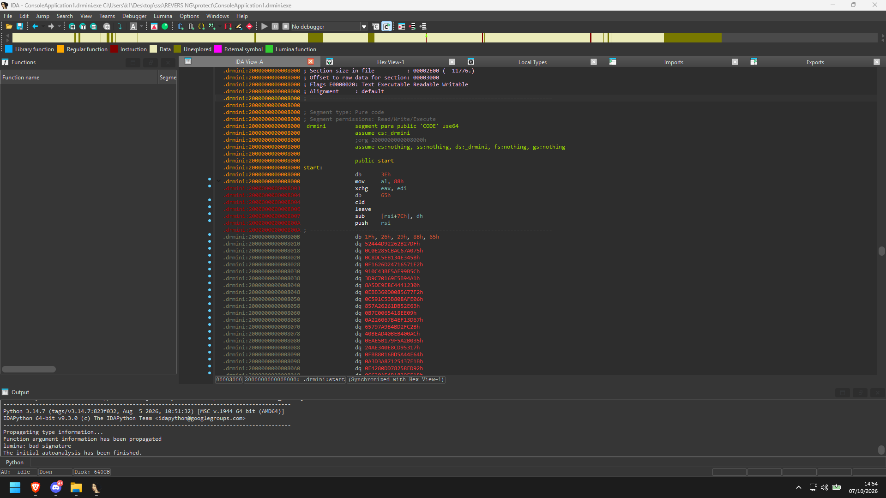

# Everlasting-Protector


## Exclamation-mark

Everlasting is an actively developed binary-to-binary software protector targeting x64 Windows Portable Executables (PE).
The project is under active development. Not all planned features and services are currently available.

We are closed source, we are not a company. We are 2 individuals working on this projects with
the service currently being distributed privately due to it still being in its early and experimental phase.

Our main goal is to specifically join in and help developers protect against artificial intelligence assisted 
reversing tools which have already started breaking down commercial ones which includes but is not limited to:

[VMProtect](https://vmpsoft.com)

[Themida](https://www.oreans.com/Themida.php)

more to follow that have been known to be vulnerable against artificial intelligence.

The following components are still in development:

- Licensing service.
- Developer storefront system.
- Official developer connectors.
- Developer server SDK.
- UDP-based licensing communication.
- Assembly instruction streaming.
- Data and constant streaming.
- Remote Procedure Calls (RPC).

The licensing and storefront systems should not be considered released functionality.

## Question-mark

Everlasting is a binary-to-binary software protector developed by [ioallocate](https://github.com/ioallocate) and [torete (also known as pity)](https://github.com/toreto67), dating back to September 27.

It targets x64 Windows PE binaries and provides code protection, virtualization, import protection, runtime encryption, decoy generation, anti-analysis mechanisms, and binary hardening.

Its primary purpose is to make reverse engineering more difficult for both human analysts and AI-assisted analysis tools.

### Strings and Code

- String encryption.
- Import hiding.
- Code encryption.
- Sleep mask.
- Page-level string encryption.
- On-demand string decryption.
- Per-page key protection.

### Virtualization

- Code virtualization through marked regions.
- Automatic virtualization.
- Strong / Weak protection split.
- Per-build VM interpreter.
- VM junk generation.

### Imports and System Calls

- Direct system calls.
- Import re-encryption.
- Per-build API hashing.
- Per-build call thunks.
- Fake import table.
- Hidden function pointers.
- Optional hook detection.
- Process-bound import keys.

### Decoy Engine

- Runtime decoy pages.
- Per-build unique protection.
- Multi-type decoy content.
- Weak, Balanced, and Strong protection levels.
- Live decoy updates.
- Decoy isolation.
- Embedded decoys:
  - RTTI.
  - Exports.
  - Resources.
  - Debug strings.
  - Fake TLS callbacks.
  - AI traps.
- Entry-point call graph.
- Scaled decoy and junk volume.

### Anti-Analysis and Tamper Response

- Anti-debug.
- Anti-dump.
- Anti-patch.
- ETW neutralization.
- Anti-disassembly.
- Anti-VM.
- Environment checks.
- Layered tamper responses.
- Encrypted tamper messages.
- Anti-dump memory guards.
- Scaled static obfuscation.
- Noisy tamper mode.
- Custom message box.
- Anonymous threads.
- Self-verification across stub and code.
- Split key protection.

### Binary Hardening

- Zero `.pdata`.
- Debug information cleanup.
- Signature handling.
- Structural obfuscation.
- Relocation scrambling.
- Header mutation.
- Encrypted watermark.

### Example 

This shows a sample file packed using Everlasting analyzed with IDA.

<p align="center">
  
</p>

Note: you may be wondering, why are the sections called ".drmini" and why is the suffix of the file "drmini" too?
Not too long ago we renamed our project to everlasting symbolizing the duration and key idea of this packer.

### Licensing and Developer Services

The licensing and storefront systems are currently in development.

#### Developer Storefront

Developers will be able to open their own storefront through the Everlasting service and host their products on it.

Planned functionality:

- Product hosting.
- Product management.
- User management.
- License key management.
- Product member management.
- Activity and event logs.
- Product administration.

Developers will retain control over their individual products, their associated users, and their licenses.

#### Official Connectors

Everlasting will provide official connectors to participating developers.

These connectors will allow developers to integrate their products with Everlasting's services, including:

- Code protection integration.
- Licensing integration.
- License validation.
- Product authorization.
- Storefront integration.

#### Developer Dashboard

Developers will have access to a management dashboard where they can:

- Create and manage license keys.
- Revoke and modify license keys.
- Manage users associated with their products.
- Manage product members.
- Review product-related logs.
- Manage their storefront listings.
- Control their products.

Everlasting will handle the underlying service infrastructure and user management.

#### Developer Server SDK

Developers will receive an SDK for their own servers, allowing them to integrate Everlasting's user and licensing functionality into their websites and services through simple function calls.

Planned SDK functionality includes:

- User registration.
- User login.
- Session management.
- Retrieving user profile information.
- License key redemption.
- License expiry retrieval.
- Profile customization.
- Profile picture management.
- Username management.

The SDK will allow developers to control signups, login, license redemption, and profile-related functionality without implementing the underlying licensing and user infrastructure themselves.

Example TypeScript integration:

```typescript
import "dotenv/config";
import { EverlastingSDK } from "everlasting-sdk";

const everlasting = new EverlastingSDK();

const signup = await everlasting.signUp("exampleUser", "password");
const login = await everlasting.signIn("exampleUser", "password");

const sessionToken = login.session_token;
const profile = await everlasting.getProfileData(sessionToken);

console.log("profile picture -> ", profile.profilePicture);
console.log("username -> ", profile.username);
console.log("license expiry -> ", profile.licenseExpiry);

const redemption = await everlasting.redeemLicenseKey(
    sessionToken,
    "LICENSE-XXXX-XXXX"
);
```

#### C++ Integration

The protected C++ application will use a minimal integration interface:

```cpp
everlasting.start();

// Protected application code

everlasting.end();
```

Developers only need to place these calls at the beginning and end of their application.

The protector uses these markers to determine the integration boundaries. During the protection build process, the required licensing components are embedded into the resulting binary automatically.

This removes the need for developers to manually implement licensing functionality inside their C++ applications.

## Dot

Everlasting is actively developed. Features, interfaces, and service functionality may change during development.

The licensing service, developer storefront, official connectors, developer SDK, and remote streaming functionality are still in development.

## At

- **ioallocate** — Project developer.
- **torete (pity)** — Project developer.

Repositories:

- https://github.com/ioallocate
- https://github.com/toreto67

## Add

Additional tools, integrations, and project-related resources will be documented here as they become available.
